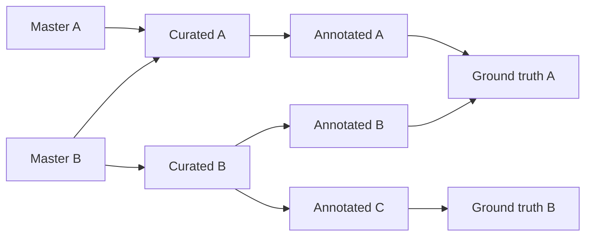

# Dataset repository template

Use this repository as a starting point for a dataset held in GitHub and discoverable through a data portal. It includes a [Data Package 2.0](https://datapackage.org/standard/data-package/) descriptor and a clearly marked placeholder resource. **Replace all example metadata and `input.csv` before publishing or releasing a dataset.** The repository is the source of its data; the portal is a reviewed catalogue, not a mirror of source data. Optional public summaries are the exception described below.

## Create a dataset repository

1. In GitHub, choose **Use this template → Create a new repository**. A suggested name is `ds-<task>-<user>` (lowercase, hyphen-separated), e.g. `ds-transcription-annotator01`. Avoid personal names or sensitive identifiers in public repository names.
2. Choose repository visibility deliberately. A public catalogue record does not grant access to a private repository. Check consent, permissions, licensing, and file size before adding data.
3. Replace the package `name` with a stable lowercase identifier and `title` with the human-readable dataset title. Update `description` and subject `keywords` in `datapackage.json`. Choose the dataset's primary stage from `stage.config.json` by keeping exactly one `stage:` keyword (replace the sample `stage:master` if it does not apply); other subject keywords are unrestricted. Replace the `created` example with the accurate RFC 3339 date-time for this package/data, or remove it if unknown; do not reuse the template's placeholder date. Replace the contributor example with the actual person or organization and their Data Package contributor roles, or remove it if unknown. Only add `licenses` or raw `sources` when accurate and safe to publish.
4. Replace `input.csv` with the real resource, or remove it and update `resources` to list the real files. Resource paths are relative to the repository root; organize files in any folders and list each resource in `datapackage.json`. Do not leave the placeholder row in a real dataset.
5. Document provenance, selection criteria, annotation methods, ownership/contact, access terms, status, and how to use the data in this README. Share only details safe for the repository's audience.
6. With Node.js 22+, run `node --test scripts/*.test.mjs` and `node scripts/validate-datapackage.mjs`. No dependency installation is needed. The GitHub Action repeats these checks on pull requests targeting `main` and pushes to `main`; it can also be run manually.

## Data Package descriptor

`datapackage.json` follows the Data Package 2.0 descriptor profile. `name` is the stable machine-readable identifier; `title` is the human label. `resources` is required and lists one or more local data resources by unique name and repository-relative path. Resource paths must resolve to files inside the repository. The template requires one primary-stage keyword. `stage.config.json` is the validator's source of allowed values and their display labels: `stage:master` for source-of-record data, `stage:curated` for cleaned/transformed data, `stage:annotated` for labelled/enriched data, or `stage:ground-truth` for data for evaluating and/or fine-tuning models. If you change the allowed values, coordinate the separate portal configuration before publishing records. If a dataset underwent several steps, choose its primary stage and explain the processing in this README. This is a local keyword convention, not a Data Package field or a claim about its parent dataset. The validator checks the descriptor fields used by this template and the existence and safety of local resource paths; it also checks the contents of optional `buckets.csv` as described below. It is not a complete implementation of every Data Package rule, does not inspect other resource contents, and cannot determine whether data is safe to publish.

New dataset repositories use `datapackage.json` as their metadata input. Package `sources[]` is for genuine upstream origins, not automatic links to portal catalogue parents. The portal's internal `derivedFrom` references are separate; stage display is implemented locally in the portal but unreviewed, and mapping reviewed upstream relationships into the portal is future work, not performed by the current onboarding. The portal's GitHub onboarding maps package `title` to its catalogue display name and derives publisher and repository links from GitHub. A public repository may have its resources linked from the catalogue after a release and human review; the portal does not copy ordinary resource bytes. The public bucket-summary exception below applies to both public and restricted repositories. A restricted repository contributes safe metadata and a credential-free landing-page link to the public catalogue. Its only permitted file-copy exception is an explicitly public `buckets.csv` summary; underlying restricted resource paths and files must not be exposed there. Nothing in this template automatically publishes a catalogue record.

### Dataset stages and derivation



Arrows show possible derivations, not required steps or confirmed lineage. Each node represents an example dataset at its labelled stage. A dataset can combine multiple upstream datasets from one or more earlier stages; master collections can combine multiple source datasets. For example, a ground-truth dataset may combine master, curated, and annotated inputs. Keep one primary-stage keyword per dataset and document only verified upstream sources and processing steps.

## Optional public bucket summary

Add a root-level `buckets.csv` to summarize the dataset for the portal. **Its labels and counts will be public, even when the dataset repository is restricted.** Check disclosure, consent, and permissions before adding it. The file is optional; no sample summary is shipped with the template.

The CSV needs exactly two columns with headers: any nonempty label-column name other than `count`, followed by `count`. Labels must be nonempty and unique after trimming. Counts must be non-negative integers no larger than `9007199254740991`. At least one data row is required. Zero counts, quoted labels, UTF-8 BOM, and LF/CRLF line endings are supported. The maximum file size is 1,000,000 bytes. Numeric-looking labels such as `001` remain text.

Synthetic example:

```csv
category,count
example-a,10
example-b,0
```

Describe it with the existing Data Package resource fields by adding an entry to `resources[]`:

```json
{
  "name": "buckets",
  "path": "buckets.csv",
  "format": "csv",
  "title": "Public bucket summary"
}
```

The existing validation command and CI check root `buckets.csv` whenever present, even if it has not been declared as a resource. Malformed CSV, invalid counts, directories, and symlinks fail validation. The reserved resource name `buckets` must refer to this root CSV, not another file.

Portal onboarding reads the summary from a suitable published SemVer release reachable from `main`, for public and restricted repositories alike. It validates the summary, then copies it into the portal only on confirmed apply and renders a horizontal bar chart. Without a suitable release, no summary is imported. Only this public summary is copied; it does not change access to the underlying dataset. Creating a release or applying an import does not automatically publish a catalogue record. Copied summary bytes are public in the portal repository even while their catalogue record is a draft.

## Releasing this template or a dataset repository

The copied `release.yml` workflow works in each repository. After `Validate metadata` succeeds on a push to `main`, Release Please uses Conventional Commits to open or update a release PR when a version bump is warranted. The PR updates the release manifest, `CHANGELOG.md`, and `datapackage.json`'s `version` to the same release version. The descriptor update uses Release Please's [JSON extra-file updater](https://github.com/googleapis/release-please/blob/v17.3.0/docs/customizing.md#updating-arbitrary-json-files), configured in `release-please-config.json`; keep the `version` field as a semantic-version string without a `v` prefix. Review that PR and merge it to create the version tag and GitHub Release. Ordinary feature merges do not publish immediately; docs/chore-only changes normally do not warrant a bump. Release management ignores PR CI, failed CI, stale results, and tag pushes.

A new repository starts at `0.1.0` on its first release. When creating a dataset repository from this template, reset `.release-please-manifest.json` to `{}`, set `datapackage.json`'s `version` to `"0.0.0"` (the unreleased placeholder), and remove any inherited `CHANGELOG.md` before its first release so it does not inherit the template's release version or history. Keep the descriptor's `version` field: the JSON updater replaces an existing version string. The first release PR replaces `"0.0.0"` with `"0.1.0"`.

Use squash merges with Conventional Commit PR titles: `feat(data): add annotated pages` (minor), `fix(data): correct labels` (patch), or `feat(data)!: change the annotation schema` / a `BREAKING CHANGE:` footer (major). Release Please manages the descriptor version, release manifest, and changelog; apart from the one-time new-repository reset above, do not manually edit these version values or its generated release files. A release tag records a snapshot; catalogue publication is a separate human-reviewed decision.

Before enabling releases in each repository:

1. Treat `main` as reviewed, releasable data. Require PRs and the metadata validation check; restrict direct pushes to `main`. The workflow responds to successful pushes to `main`, not just PR merges. It requests Contents, Issues, and Pull requests write permissions for its built-in `GITHUB_TOKEN`; allow GitHub Actions to create pull requests in **Settings → Actions → General** if repository policy requires it. No extra secret is needed.
2. Review visibility, consent, and access restrictions. GitHub automatically offers source archives of tagged repositories; tracked data files may be included and made public with a public repository. Keep commit subjects and release descriptions free of private information.
3. Review each generated release PR. Because it is opened with `GITHUB_TOKEN`, GitHub does not automatically run `Validate metadata` on that PR. Manually run **Validate metadata** on its branch and inspect the diff and result before merging. Re-run validation if Release Please updates the branch, and confirm manual validation satisfies required-check rules.
