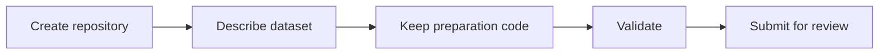

# Dataset repository template

Create a dataset repository with [Data Package 2.0](https://datapackage.org/standard/data-package/) metadata and validation. Keep metadata, provenance, methods, limitations and usage guidance in the dataset repository.

**Replace all example metadata and `input.csv` before publishing or releasing. Never add secrets or restricted data to a public repository.**

## 1. Find existing data

Search the [Budaya Lab Data Portal](https://data.budaya-lab.org/) first. Follow source links and check provenance, suitability and access conditions before creating another dataset.

## 2. Create a dataset repository



1. Choose **Use this template → Create a new repository** in GitHub. Suggested name: `ds-<task>-<user>`. Avoid sensitive identifiers. Choose visibility after checking consent, permissions, licensing and file size.
2. Clone the new repository fully. With Node.js 24+ and pnpm 12.x, run `pnpm init:dataset` at its root before making new commits. This clears the inherited release manifest, sets the dataset version to `"0.0.0"` and removes the inherited changelog. It does not edit other metadata or data. See [cleanup safeguards](docs/reference.md#initialize-a-new-dataset).
3. Replace `input.csv` with your data. List each file or directory resource in `datapackage.json` with a unique `name`, a nonblank `title` and a repository-relative `path`. A directory covers its contents; omit its `format`. Use optional `count` for item totals, not bytes. See [resource rules](docs/reference.md#resource-counts-and-directories).
4. Replace the package `name` (stable lowercase identifier), `title`, `description` and `keywords`. Both `title` and `description` are required, nonblank text. Include exactly one nonempty `task:<value>`, `project:<value>` and stage keyword (`stage:master`, `stage:curated`, `stage:annotated` or `stage:ground-truth`). Other subject keywords are allowed. See [metadata and stage rules](docs/reference.md#metadata-and-stages).
5. Replace the example `created` date and `contributors`, or remove them if unknown. Add licences and upstream sources only when available and safe to share. Do not invent metadata or lineage.

## 3. Describe the dataset

Replace this README with the dataset's provenance, selection criteria, methods, limitations, ownership/contact, access terms, status and usage guidance. Keep details safe for the repository's audience.

Optionally, use [Dataset Steward](https://github.com/budaya-lab/dataset-steward#readme) to validate descriptions and generate or refresh READMEs. Put handwritten notes below `<!-- notes -->` before regeneration.

### Optional public bucket summary

Add root-level `buckets.csv` to summarize the dataset as a bar chart in the portal. **Labels and counts will be public, even for restricted datasets.** Review disclosure, consent and permissions before adding it; the portal does not grant access to the underlying data.

Use two columns: a label column, then `count`. Labels must be nonempty and unique; counts must be non-negative integers. Synthetic example:

```csv
category,count
example-a,10
example-b,0
```

Add this entry to `datapackage.json`'s `resources`:

```json
{
  "name": "buckets",
  "path": "buckets.csv",
  "format": "csv",
  "title": "Public bucket summary"
}
```

CI checks `buckets.csv` whenever present, even if undeclared. Portal onboarding copies the summary only from a suitable published release and after confirmed apply. Copied summaries are public even for draft catalogue records. See [full format limits and import rules](docs/reference.md#optional-public-bucket-summary).

## 4. Add preparation code

Include any scripts or notebooks used to clean, transform or prepare the dataset.
Document how to run them, their dependencies, and their input/output files.
Remove credentials, private paths and sensitive notebook outputs before sharing.

## 5. Validate, release and catalogue

With Node.js 24+ and pnpm 12.x, run from the repository root:

```sh
pnpm install --frozen-lockfile --ignore-scripts
pnpm typecheck
pnpm test
pnpm validate
```

Fix errors, then open a PR to `main`. Require review and the **Validate metadata** check (`metadata`) before merging. Validation is read-only: it never changes files or the supplied descriptor. It checks required metadata, supplied optional metadata, local paths and optional bucket summaries—not full Data Package conformance, other data contents or permission to publish.

[Lazydata](https://github.com/budaya-lab/lazydata/releases/tag/v1.0.0) supplies the compiled validator and matched policy. This template pins its release archive and lockfile; dataset-local policy is not used. See [dependency updates](docs/reference.md#validation-dependency).

For a versioned release, follow the [release guide](docs/reference.md#releases). Then follow the [Data Portal onboarding guide](https://github.com/budaya-lab/data-portal#add-a-dataset) to review and add a catalogue record. **A GitHub release does not automatically publish a catalogue entry.**
