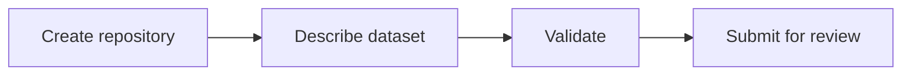

# Dataset repository template

Create a dataset repository with [Data Package 2.0](https://datapackage.org/standard/data-package/) metadata and validation. Keep metadata, provenance, methods, limitations and usage guidance in the dataset repository.

**Replace all example metadata and `input.csv` before publishing or releasing. Never add secrets or restricted data to a public repository.**

## 1. Find existing data

Search the [Budaya Lab Data Portal](https://data.budaya-lab.org/) first. Follow source links and check provenance, suitability and access conditions before creating another dataset.

## 2. Create a dataset repository



1. Choose **Use this template → Create a new repository** in GitHub. Suggested name: `ds-<task>-<user>`. Avoid sensitive identifiers. Choose visibility after checking consent, permissions, licensing and file size.
2. Reset inherited release state: set `.release-please-manifest.json` to `{}`, set `datapackage.json`'s `version` to `"0.0.0"`, and remove `CHANGELOG.md`.
3. Replace `input.csv` with your data. List each resource in `datapackage.json` with a unique `name` and a path relative to the repository root. Files may be in any folder inside the repository.
4. Replace the package `name` (stable lowercase identifier), `title`, `description` and subject `keywords`. Keep exactly one stage keyword: `stage:master`, `stage:curated`, `stage:annotated` or `stage:ground-truth`. See [metadata and stage rules](docs/reference.md#metadata-and-stages).
5. Replace the example `created` date and `contributors`, or remove them if unknown. Add licences and upstream sources only when available and safe to share. Do not invent metadata or lineage.

## 3. Describe the dataset

Replace this README with the dataset's provenance, selection criteria, methods, limitations, ownership/contact, access terms, status and usage guidance. Keep details safe for the repository's audience.

Optionally, use [Dataset Steward](https://github.com/budaya-lab/dataset-steward#readme) to validate descriptions and generate or refresh READMEs. Put handwritten notes below `<!-- notes -->` before regeneration.

### Optional public bucket summary

Add root-level `buckets.csv` to summarize the dataset as a bar chart in the portal. **Labels and counts will be public, even for restricted datasets.** Review disclosure, consent and permissions before adding it; the portal does not grant access to the underlying data.

Use two columns: a label column, then `count`. Labels must be nonempty and unique; counts must be non-negative integers. Synthetic example:

```csv
category,count
example-a,10
example-b,0
```

Add this entry to `datapackage.json`'s `resources`:

```json
{
  "name": "buckets",
  "path": "buckets.csv",
  "format": "csv",
  "title": "Public bucket summary"
}
```

CI checks `buckets.csv` whenever present, even if undeclared. Portal onboarding copies the summary only from a suitable published release and after confirmed apply. Copied summaries are public even for draft catalogue records. See [full format limits and import rules](docs/reference.md#optional-public-bucket-summary).

## 4. Validate, release and catalogue

With Node.js 22+, run from the repository root. No dependencies are needed.

```sh
node --test scripts/*.test.mjs
node scripts/validate-datapackage.mjs
```

Fix errors, then open a PR to `main`. Require review and the **Validate metadata** check (`metadata`) before merging. Validation checks selected metadata, local paths and optional bucket summaries—not full Data Package conformance, other data contents or permission to publish.

For a versioned release, follow the [release guide](docs/reference.md#releases). Then follow the [Data Portal onboarding guide](https://github.com/budaya-lab/data-portal#add-a-dataset) to review and add a catalogue record. **A GitHub release does not automatically publish a catalogue entry.**
