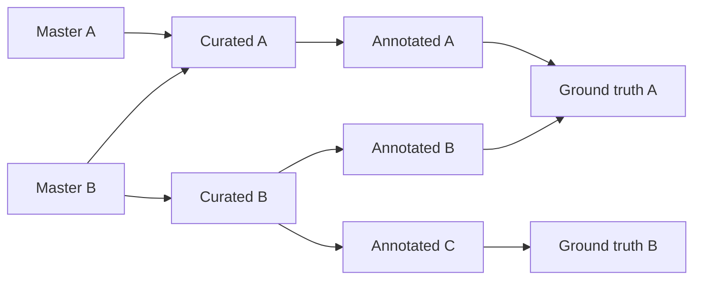

# Dataset reference

[Back to setup](../README.md)

## Metadata and stages

`datapackage.json` uses [Data Package 2.0](https://datapackage.org/standard/data-package/) plus lab-specific conventions:

| Field | Rule |
| --- | --- |
| `name` | Required stable lowercase package identifier. |
| `title`, `description` | Required nonblank text. |
| `resources` | Required nonempty array. Each resource needs a unique lowercase `name`, nonblank `title` and local, repository-relative file or directory `path`. Paths must resolve inside the repository. |
| `keywords` | Exactly one `stage:` keyword; other keywords describe the subject. |
| `created` | Optional RFC 3339 date-time, including timezone offsets and fractional seconds. Omit if unknown. |
| `contributors` | Optional nonempty array of nonempty objects. Supplied `roles` must be a nonempty array of nonblank strings. |
| `licenses` | Optional nonempty array of objects, each with a nonblank `name` or `path`. Names use letters, digits, dots, underscores or hyphens. |
| `sources` | Optional array of nonempty objects; an empty array is allowed. |
| `version` | Semantic-version string without a `v` prefix. Managed by Release Please after the initial reset. |

Optional does not mean unchecked: supplied values must satisfy the rules above.
Known text fields in contributor, licence and source entries must be nonblank strings.
Metadata paths are references: validation does not open or fetch them. These checks do
not verify licence authority, source availability, full Data Package conformance or
permission to publish. Include only accurate, public-safe metadata; omit unknown values.

Validation never changes files or the supplied descriptor. Counting, repairs and README
generation belong to downstream tools. Descriptors missing the newly required package
`title`/`description` or resource `title` will fail; add accurate descriptions before
validating again. Existing dataset repositories are not updated automatically.

Choose the dataset's **primary stage**, not a required sequence:

| Keyword | Use for |
| --- | --- |
| `stage:master` | Source-of-record data. |
| `stage:curated` | Cleaned or transformed data. |
| `stage:annotated` | Labelled or enriched data. |
| `stage:ground-truth` | Data for evaluating or fine-tuning models. |

### Dataset stages and derivation



Arrows show possible derivations, not required steps or confirmed lineage. A dataset may combine several inputs or processing steps. Document only verified sources and methods; a stage does not establish lineage. Data Package `sources[]` and the portal's `derivedFrom` catalogue links are separate. Onboarding does not infer parent links.

[`stage.config.json`](../stage.config.json) defines allowed stages and display labels. Coordinate changes with the portal configuration before publishing records.

## Resource counts and directories

Use `resources[].count` for item totals, not storage size. It is an optional integer from `0` to `9007199254740991`. Omit unknown or unsupported counts; `0` means empty.

| Resource | `count` means |
| --- | --- |
| CSV | Data rows, excluding the header. |
| JSON | Top-level array items or object members. |
| Directory | Files recursively, excluding hidden files and hidden directories. |

Dataset Steward recomputes counts for these single-path resources. Template validation checks the declared count's type and range, not its accuracy. Multi-path resources and other file types have no computed count. Do not sum resource counts into a dataset total: a CSV and a directory may describe the same items.

A directory resource covers its contents without listing every file. Prefer a trailing slash and **omit `format`**, rather than using `dir` or `directory`. Synthetic example:

```json
{
  "name": "annotations",
  "title": "Annotations",
  "path": "annotations/",
  "count": 120
}
```

Directory paths and `count` are lab extensions. Standard Data Package [`format`](https://datapackage.org/standard/data-resource/#format) describes a file format such as `csv`; [`bytes`](https://datapackage.org/standard/data-resource/#bytes) records storage size. Directory validation checks the referenced path, not every file inside it. Portal onboarding remains subject to its own resource rules; this does not automatically publish directory contents.

## Dataset Steward

Follow [Dataset Steward's README](https://github.com/budaya-lab/dataset-steward#readme) for its commands and requirements. README generation replaces everything above `<!-- notes -->` and preserves text below it; move handwritten notes there first.

## Optional public bucket summary

Add `buckets.csv` at the repository root only if you want a public summary. **Labels and counts are public even for restricted datasets.** Review disclosure, consent and permissions first. No sample summary is included in the template.

Synthetic example:

```csv
category,count
example-a,10
example-b,0
```

Requirements:

- Exactly two columns: a nonempty label header other than `count`, then `count`.
- At least one data row; labels must be nonempty and unique after trimming.
- Counts must be integers from `0` to `9007199254740991`.
- Maximum size: 1,000,000 bytes. No symlinks or directories.

Quoted labels, UTF-8 BOM and LF/CRLF line endings are supported. Numeric-looking labels such as `001` stay text.

Declare it using standard `resources[]` fields:

```json
{
  "name": "buckets",
  "path": "buckets.csv",
  "format": "csv",
  "title": "Public bucket summary"
}
```

The reserved name `buckets` must refer to this root CSV. Local validation and CI check the file whenever present, even if undeclared.

Portal onboarding reads it from a suitable published SemVer release reachable from `main`. On confirmed apply, it copies the validated summary and displays a bar chart. Without a suitable release, no summary is imported. Copied summaries are public in the portal repository even for draft catalogue records; restricted data access stays unchanged.

## Releases

### Enable releases once per repository

- Require reviewed PRs and the `metadata` check on `main`; restrict direct pushes. Any successful validated push to `main` can trigger release management.
- Review visibility, consent and access. GitHub's automatic source archives include tracked data; public repositories expose those files. Keep commit subjects and release descriptions public-safe.
- The workflow uses the built-in `GITHUB_TOKEN` with Contents, Issues and Pull requests write permissions. No extra secret is needed. If policy requires it, allow Actions to create PRs in **Settings → Actions → General**.

For a new dataset, reset `.release-please-manifest.json` to `{}`, set `datapackage.json`'s `version` to `"0.0.0"`, and remove the inherited `CHANGELOG.md`. Keep the version field: the first release PR replaces `"0.0.0"` with `"0.1.0"`.

### Create a release

1. Use Conventional Commit squash PR titles: `feat(data): add annotated pages` (minor), `fix(data): correct labels` (patch), or `feat(data)!: change annotation schema` (major). A `BREAKING CHANGE:` footer also signals a major change.
2. After **Validate metadata** succeeds on a current push to `main`, Release Please opens or updates a release PR when a bump is warranted. Docs/chore-only changes normally do not trigger one. Failed, stale, PR and tag CI results do not trigger releases.
3. Review the release PR. **Manually run Validate metadata on its branch**: GitHub does not automatically trigger PR CI for PRs created with `GITHUB_TOKEN`. Rerun after branch updates and confirm the result satisfies required checks.
4. With owner approval, merge the release PR to create the tag and GitHub Release. Ordinary feature merges do not publish a release immediately.

Release Please keeps `datapackage.json`'s version, the manifest and changelog aligned. Do not edit them manually except for the initial reset. The descriptor uses the [JSON extra-file updater](https://github.com/googleapis/release-please/blob/v17.3.0/docs/customizing.md#updating-arbitrary-json-files) in [`release-please-config.json`](../release-please-config.json).

## Catalogue boundaries

Follow the [portal onboarding guide](https://github.com/budaya-lab/data-portal#add-a-dataset); release and catalogue publication require separate human review.

- Public repositories: the portal maps the package title to its display name, derives publisher/repository links from GitHub, and links reviewed released resources. It does not copy ordinary data files.
- Restricted repositories: publish only safe metadata and a credential-free HTTPS landing-page link. Never expose underlying restricted paths or files. The only file-copy exception is an explicitly public bucket summary.
- Template changes affect future repositories, not existing datasets or catalogue records.
